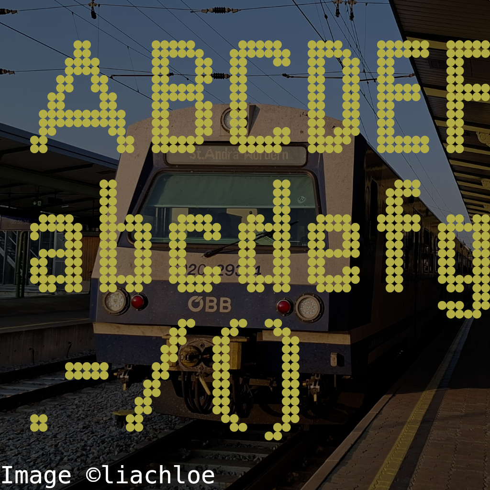
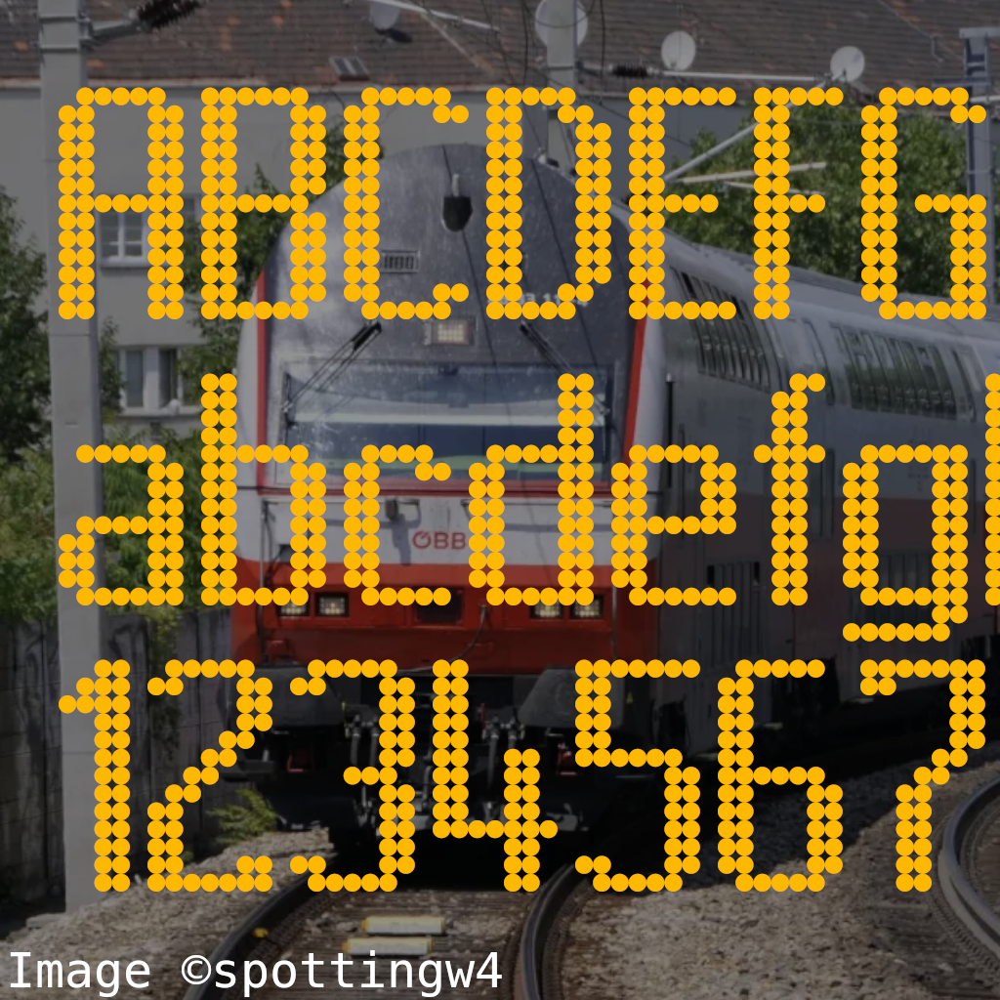

# railfonts

This font pack replicates the font of various displays on railway vehicles.

## List of fonts in the repository:

### **ÖBB class 4020 outside destination displays**

(mostly fully recreated; some uncommon letters are missing. There is a smaller version for longer destination names, but only the normal full-size font is included in the repository)

### **ÖBB regional-train doubledecker (DoSto) inside matrix displays**

(mostly fully recreated; some uncommon letters are missing. Some modernized carriages feature infotainment displays instead of the matrix ones, the fonts on those aren't included)

### **ÖBB regional-train doubledecker (DoSto) inside matrix displays** (slim)
(work in progress; same as the normal DoSto font, but the slim variant, which is used for displaying longer text)
### **ÖBB regional-train Bombardier Talent (class 4023/4024/4124) inside matrix displays**
(work in progress)

--------

These fonts were made with [Fontstruct](https://fontstruct.com/)
